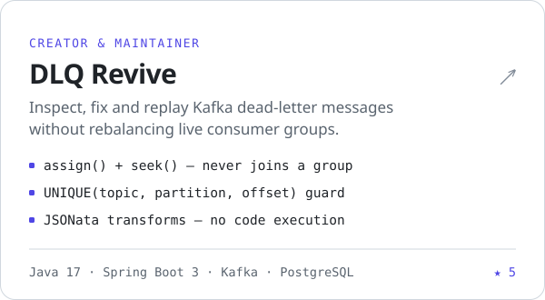
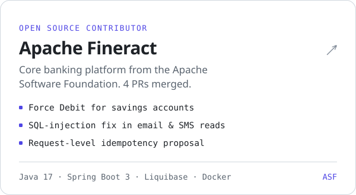
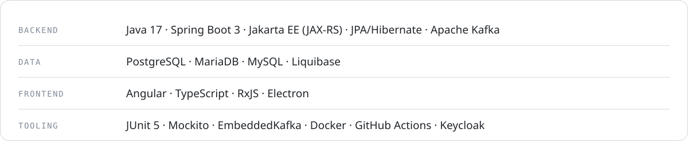

<picture>
  <source media="(prefers-color-scheme: dark)" srcset="assets/banner-dark.svg">
  
</picture>

<p align="center">
  <a href="https://saifulhuq.vercel.app"><b>Portfolio</b></a> &nbsp;·&nbsp;
  <a href="https://saifulhuq.vercel.app/projects/dlq-revive">DLQ Revive case study</a> &nbsp;·&nbsp;
  <a href="https://www.linkedin.com/in/saifulhuqs">LinkedIn</a> &nbsp;·&nbsp;
  <a href="https://leetcode.com/u/saiful_huq">LeetCode</a> &nbsp;·&nbsp;
  <a href="mailto:mohammed.saifulhuq@gmail.com">Email</a>
</p>

I'm a backend-focused software engineer at **First Insight**, building Java services for a retail analytics platform. Outside work I maintain **DLQ Revive** and contribute to **Apache Fineract**. The work I enjoy most is the part that keeps systems correct: idempotency, tenant isolation, bounded concurrency and honest failure states.

### Now

- **At work:** the survey insight engine, report sharing, and the tenant authorization rules around it · Java, Jakarta EE, MariaDB, Keycloak
- **DLQ Revive:** an open-source tool for replaying Kafka dead letters safely next to production
- **Apache Fineract:** 4 merged PRs, including Force Debit for savings accounts

### Selected work

<a href="https://github.com/Saifulhuq01/dlq-revive"><picture><source media="(prefers-color-scheme: dark)" srcset="assets/dlq-revive-dark.svg"></picture></a>&nbsp;
<a href="https://github.com/apache/fineract/pulls?q=is%3Apr+author%3ASaifulhuq01+is%3Amerged"><picture><source media="(prefers-color-scheme: dark)" srcset="assets/fineract-dark.svg"></picture></a>

### Telemetry

<picture>
  <source media="(prefers-color-scheme: dark)" srcset="assets/telemetry-dark.svg">
  
</picture>
<p align="right"><sub>Live from GitHub and LeetCode · refreshed daily by <a href=".github/workflows/telemetry.yml">a GitHub Action</a></sub></p>

### How I build

```yaml
correctness:    "survive restarts, retries, races"     # UNIQUE(topic, partition, offset)
safety:         "no Turing-complete input on servers"  # JSONata, never Groovy
kafka_hygiene:  "read-only consumers never join"       # assign() + seek(), no commits
failure_states: "never collapse distinct failures"     # wrong tenant ≠ deleted ≠ denied
```

### Stack

<picture>
  <source media="(prefers-color-scheme: dark)" srcset="assets/stack-dark.svg">
  
</picture>

### Writing

- [Replaying Kafka dead letters without breaking production](https://saifulhuq.vercel.app/projects/dlq-revive): the design decisions and trade-offs behind DLQ Revive

<p align="center"><sub>Open to backend and distributed-systems conversations. Email is the fastest way to reach me.</sub></p>
